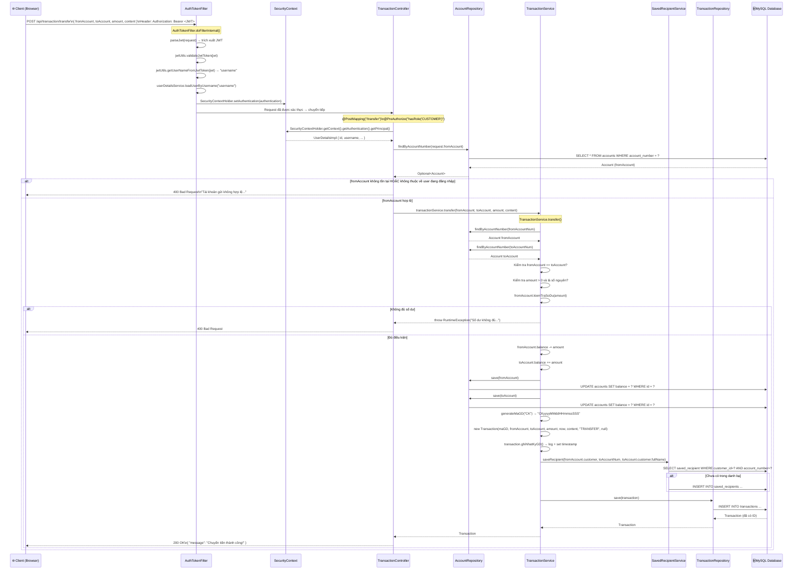

# 🏦 Luồng Hoạt Động Chức Năng Chuyển Tiền (Transfer)

> Hệ thống: **MB Bank Management System** — Spring Boot + JWT Security + JPA/MySQL

---

## 📁 Các File Liên Quan

| Tầng | File | Vai trò |
|---|---|---|
| **DTO** | `dto/TransferRequest.java` | Nhận dữ liệu từ client |
| **Security** | `security/AuthTokenFilter.java` | Xác thực JWT trước mỗi request |
| **Security** | `security/WebSecurityConfig.java` | Cấu hình quyền truy cập endpoint |
| **Security** | `security/UserDetailsImpl.java` | Lưu thông tin user đang đăng nhập |
| **Controller** | `controller/TransactionController.java` | Nhận HTTP request, phân quyền |
| **Service** | `service/TransactionService.java` | Xử lý nghiệp vụ chuyển tiền |
| **Service** | `service/SavedRecipientService.java` | Tự động lưu người nhận vào danh bạ |
| **Repository** | `repository/AccountRepository.java` | Truy vấn tài khoản từ DB |
| **Repository** | `repository/TransactionRepository.java` | Lưu giao dịch vào DB |
| **Model** | `model/Account.java` | Entity tài khoản ngân hàng |
| **Model** | `model/Transaction.java` | Entity giao dịch |

---

## 🔄 Sơ Đồ Luồng Hoạt Động



---

## 📋 Phân Tích Chi Tiết Từng Bước

### BƯỚC 1 — Client gửi Request

**File:** `dto/TransferRequest.java`

```java
// Client gửi JSON body:
{
  "fromAccount": "MB100001",
  "toAccount":   "MB100002",
  "amount":      500000,
  "content":     "Chuyển tiền cho bạn"
}
// Endpoint: POST /api/transaction/transfer
// Header: Authorization: Bearer <JWT_TOKEN>
```

DTO `TransferRequest` chứa 4 trường: `fromAccount`, `toAccount`, `amount` (`BigDecimal`), `content`.

---

### BƯỚC 2 — Bộ lọc JWT (AuthTokenFilter)

**File:** `security/AuthTokenFilter.java` → `doFilterInternal()`

```java
String jwt = parseJwt(request);           // Lấy token từ header "Bearer ..."
jwtUtils.validateJwtToken(jwt);           // Xác minh chữ ký + hết hạn
String username = jwtUtils.getUserNameFromJwtToken(jwt);
UserDetails userDetails = userDetailsService.loadUserByUsername(username);

if (!userDetails.isAccountNonLocked()) {  // Kiểm tra tài khoản có bị khóa?
    response.sendError(401, "Tài khoản bị khóa");
    return;
}
// Lưu thông tin xác thực vào SecurityContextHolder
SecurityContextHolder.getContext().setAuthentication(authentication);
```

**Quy tắc bảo mật** (`WebSecurityConfig.java`): endpoint `/api/transaction/**` → `anyRequest().authenticated()` nên **bắt buộc phải có JWT hợp lệ**.

---

### BƯỚC 3 — Controller nhận request & kiểm tra quyền sở hữu

**File:** `controller/TransactionController.java` → `transferMoney()` (dòng 31–45)

```java
@PostMapping("/transfer")
@PreAuthorize("hasRole('CUSTOMER')")         // ① Chỉ role CUSTOMER được gọi
public ResponseEntity<?> transferMoney(@RequestBody TransferRequest request) {

    // ② Lấy thông tin user đang đăng nhập từ SecurityContext
    UserDetailsImpl userDetails = (UserDetailsImpl)
        SecurityContextHolder.getContext().getAuthentication().getPrincipal();

    // ③ Tìm tài khoản nguồn trong DB
    Optional<Account> fromAccOpt = accountRepository.findByAccountNumber(request.getFromAccount());

    // ④ Kiểm tra tài khoản nguồn có thuộc về user này không?
    if (fromAccOpt.isEmpty() ||
        !fromAccOpt.get().getCustomer().getId().equals(userDetails.getId())) {
        return ResponseEntity.badRequest().body(new MessageResponse("Tài khoản gửi không hợp lệ..."));
    }

    // ⑤ Gọi service xử lý nghiệp vụ
    transactionService.transfer(request.getFromAccount(), request.getToAccount(),
                                request.getAmount(), request.getContent());

    return ResponseEntity.ok(new MessageResponse("Chuyển tiền thành công!"));
}
```

> [!IMPORTANT]
> Bước kiểm tra `fromAccOpt.get().getCustomer().getId().equals(userDetails.getId())` là bảo vệ quan trọng — đảm bảo không ai có thể chuyển tiền từ tài khoản của người khác dù biết số tài khoản.

---

### BƯỚC 4 — Service xử lý nghiệp vụ chuyển tiền

**File:** `service/TransactionService.java` → `transfer()` (dòng 58–97)

#### 4a. Load hai tài khoản từ DB

```java
// Dùng AccountRepository.findByAccountNumber() — truy vấn theo số TK
Account fromAccount = accountRepository.findByAccountNumber(fromAccountNum)
    .orElseThrow(() -> new RuntimeException("Source account not found"));
Account toAccount   = accountRepository.findByAccountNumber(toAccountNum)
    .orElseThrow(() -> new RuntimeException("Destination account not found"));
```

**File:** `repository/AccountRepository.java`
```java
Optional<Account> findByAccountNumber(String accountNumber);
// → Spring JPA tự sinh: SELECT * FROM accounts WHERE account_number = ?
```

#### 4b. Kiểm tra điều kiện nghiệp vụ

```java
// Không được chuyển cho chính mình
if (fromAccountNum.equals(toAccountNum))
    throw new RuntimeException("Không thể chuyển tiền cho chính mình!");

// Số tiền phải hợp lệ và > 0
if (amount == null || amount.compareTo(BigDecimal.ZERO) <= 0)
    throw new RuntimeException("Số tiền chuyển khoản không hợp lệ!");

// Số tiền phải là số nguyên (không có phần thập phân)
if (amount.scale() > 0 && amount.stripTrailingZeros().scale() > 0)
    throw new RuntimeException("Số tiền chuyển khoản phải là số nguyên!");

// Kiểm tra số dư — dùng method của Account entity
if (!fromAccount.kiemTraSoDu(amount))    // ← Account.java dòng 45-47
    throw new RuntimeException("Số dư tài khoản không đủ...");
```

**File:** `model/Account.java` → `kiemTraSoDu()` (dòng 45–47):
```java
public boolean kiemTraSoDu(BigDecimal amount) {
    return this.balance.compareTo(amount) >= 0;
}
```

#### 4c. Cập nhật số dư (trong @Transactional)

```java
// Toàn bộ method được đánh dấu @Transactional → rollback nếu lỗi giữa chừng
fromAccount.setBalance(fromAccount.getBalance().subtract(amount));  // Trừ tiền người gửi
toAccount.setBalance(toAccount.getBalance().add(amount));           // Cộng tiền người nhận

accountRepository.save(fromAccount);  // UPDATE accounts SET balance=? WHERE id=?
accountRepository.save(toAccount);    // UPDATE accounts SET balance=? WHERE id=?
```

#### 4d. Tạo bản ghi giao dịch

```java
String maGD = generateMaGD("CK");
// → "CK" + "20260516221347123" = "CK20260516221347123"

Transaction transaction = new Transaction(
    maGD,        // mã giao dịch nghiệp vụ
    fromAccount, // tài khoản nguồn
    toAccount,   // tài khoản đích
    amount,      // số tiền
    LocalDateTime.now(),
    content,     // nội dung chuyển khoản
    "TRANSFER",  // loại giao dịch
    null         // performedBy = null (do khách hàng tự thực hiện)
);

transaction.ghiNhatKyGD(); // Log ra console + set timestamp
```

**File:** `model/Transaction.java` → `ghiNhatKyGD()` (dòng 51–55):
```java
public void ghiNhatKyGD() {
    this.timestamp = LocalDateTime.now();
    System.out.println("Recorded transaction: " + this.transactionType + " amount: " + this.amount);
}
```

#### 4e. Tự động lưu người nhận vào danh bạ

**File:** `service/SavedRecipientService.java` → `saveRecipient()` (dòng 19–24):
```java
// Nếu toAccount chưa có trong danh bạ của fromAccount.customer → tự động thêm
if (repository.findByCustomerIdAndAccountNumber(customer.getId(), accountNumber).isEmpty()) {
    SavedRecipient saved = new SavedRecipient(customer, accountNumber, fullName, null);
    repository.save(saved);
}
// Lỗi ở bước này KHÔNG làm rollback giao dịch (bọc trong try-catch)
```

#### 4f. Lưu giao dịch vào DB

```java
return transactionRepository.save(transaction);
// → INSERT INTO transactions (ma_gd, from_account_id, to_account_id, amount, timestamp, content, transaction_type, performed_by)
```

**File:** `repository/TransactionRepository.java`:
```java
// Extends JpaRepository → tự có .save()
// Query lịch sử:
List<Transaction> findByFromAccount_AccountNumberOrToAccount_AccountNumberOrderByTimestampDesc(
    String fromAccount, String toAccount);
```

---

### BƯỚC 5 — Controller trả kết quả

```java
return ResponseEntity.ok(new MessageResponse("Chuyển tiền thành công!"));
// HTTP 200 OK: { "message": "Chuyển tiền thành công!" }
```

Nếu có exception bất kỳ:
```java
return ResponseEntity.badRequest().body(new MessageResponse(e.getMessage()));
// HTTP 400 Bad Request: { "message": "<lý do lỗi>" }
```

---

## 🔒 Cơ Chế Bảo Mật Áp Dụng

| Lớp bảo vệ | Cơ chế | File |
|---|---|---|
| Xác thực JWT | `AuthTokenFilter` kiểm tra Bearer token | `security/AuthTokenFilter.java` |
| Phân quyền role | `@PreAuthorize("hasRole('CUSTOMER')")` | `controller/TransactionController.java:30` |
| Kiểm tra sở hữu | So sánh `customer.id` với `userDetails.id` | `controller/TransactionController.java:35` |
| Kiểm tra số dư | `account.kiemTraSoDu(amount)` | `model/Account.java:45` |
| Tính toàn vẹn DB | `@Transactional` → rollback toàn bộ nếu lỗi | `service/TransactionService.java:58` |

---

## 🗄️ Cấu Trúc Bảng Database

```
accounts
├── id (PK)
├── account_number (UNIQUE)
├── balance
├── loai_tk
├── ngay_mo
├── status
└── customer_id (FK → customers.id)

transactions
├── id (PK)
├── ma_gd (UNIQUE) ← "CKyyyyMMddHHmmssSSS"
├── from_account_id (FK → accounts.id) ← NULL nếu DEPOSIT
├── to_account_id   (FK → accounts.id) ← NULL nếu WITHDRAW
├── amount
├── timestamp
├── content
├── transaction_type ← "TRANSFER" / "DEPOSIT" / "WITHDRAW"
└── performed_by ← NULL nếu khách tự chuyển, username nhân viên nếu quầy

saved_recipients
├── id (PK)
├── customer_id (FK)
├── account_number
└── full_name
```

---

## ⚡ Tóm Tắt Luồng (Ngắn Gọn)

```
Client
  → [JWT Header] → AuthTokenFilter (xác thực token, set SecurityContext)
  → TransactionController.transferMoney()
      ① @PreAuthorize: chỉ CUSTOMER được vào
      ② Kiểm tra fromAccount thuộc về user đang đăng nhập
      ③ Gọi TransactionService.transfer()
          a. Load fromAccount + toAccount từ AccountRepository
          b. Validate: không chuyển cho mình, amount > 0, đủ số dư
          c. @Transactional: trừ fromAccount, cộng toAccount → save cả 2
          d. Tạo Transaction entity (maGD = "CK" + timestamp)
          e. SavedRecipientService: tự động lưu người nhận vào danh bạ
          f. TransactionRepository.save(transaction) → INSERT vào DB
  → ResponseEntity 200 OK / 400 Bad Request
```
